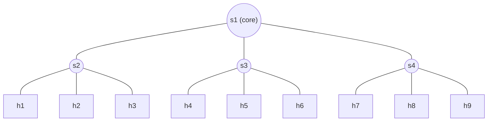

# team-sdn
# Adaptive SDN Monitoring

Adaptive polling of switch statistics in SDN, based on the PayLess algorithm.
The polling interval τ changes with traffic: it grows when traffic is stable
and shrinks on sudden changes, reducing monitoring overhead while keeping accuracy.

Built with the Ryu controller and the Mininet simulator.

## Topology: 4 switches, 9 hosts

## Topology: 4 switches, 9 hosts

UDP traffic (iperf) between host groups; the s1–s2 link carries several flows.

## References

- [PayLess: A low cost network monitoring framework for Software Defined Networks](https://ieeexplore.ieee.org/document/6838227)
- [Dynamic Telemetry and Deep Neural Networks for Anomaly Detection in 6G Software-Defined Networks](https://www.mdpi.com/2079-9292/13/2/382)
- [OpenNetMon: Network monitoring in OpenFlow Software-Defined Networks](https://ieeexplore.ieee.org/document/6838228)

## License

MIT - AGH
