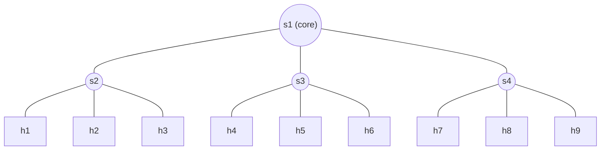

# team-sdn

Adaptive polling of switch statistics in SDN, based on the PayLess algorithm.
The polling interval τ changes with traffic: it grows when traffic is stable
and shrinks on sudden changes, reducing monitoring overhead while keeping accuracy.

Built with the Ryu controller and the Mininet simulator.

## Topology: 4 switches, 9 hosts



UDP traffic (iperf) between host groups; the s1–s2 link carries several flows.

## Repo Layout (minimal)

- `topology/` – Mininet topologies
- `scripts/` – helper scripts (Docker, scripts)
- `results/` – experiment output (future)

## Local setup (Ryu, analysis, lint)

```sh
uv sync
uv run ryu-manager ryu.app.simple_monitor_13
uv run ruff check . && uv run ruff format .
```

## Mininet (Docker)

Mininet only runs on Linux, so it runs in a privileged container:

```sh
scripts/docker-run.sh                 # shell inside the container

# inside:
   ryu-manager ryu.app.simple_monitor_13 &
   mn --custom topology/topology.py --topo montopo --link tc \
      --controller remote,ip=127.0.0.1,port=6653 --switch ovsk,protocols=OpenFlow13
cd
```

`topology/`, `scripts/` and `results/` are mounted, so edits on the host are visible without rebuilding.
